# TabVale

A Chrome and Microsoft Edge extension that replaces the browser's new tab page
with a customizable dashboard: search, multiple bookmark screens, and
backgrounds.

**Read in:** [English](README.md) · [Русский](README.ru.md) · [Deutsch](README.de.md) · [Français](README.fr.md) · [Español](README.es.md) · [Português (Brasil)](README.pt-BR.md) · [Italiano](README.it.md) · [Polski](README.pl.md) · [Türkçe](README.tr.md) · [Українська](README.uk.md) · [中文](README.zh.md) · [日本語](README.ja.md) · [한국어](README.ko.md)

> English is the source of truth. Short translations are provided for
> convenience; corrections are welcome via GitHub issues.

## Features

- **Search** with a selectable search engine. The engine list is editable and
  each engine can have its own icon.
- **Screens** — several independent bookmark sets. Switch with dots,
  horizontal swipe on empty space, or `Alt+←/→`; manage screens in settings
  and move bookmarks between them from the context menu.
- **Bookmarks** with site icons, drag-and-drop sorting, editing, deletion and
  an automatic page-title suggestion.
- **Backgrounds**: image URL, local file, solid color or gradient; image
  placement (cover, contain, tile, center).
- **Themes**: auto, light, dark.
- **Languages**: English, Russian, German, French, Spanish, Portuguese (Brazil), Italian, Polish, Turkish, Ukrainian, Chinese, Japanese and Korean; the auto mode follows the browser.
- **Context menus** for bookmark tiles, the page background, the search field,
  the empty bookmarks area and settings rows.
- **JSON import and export** of settings.
- **Responsive layout** for narrow windows and mobile orientation.

## Screenshots

All screenshots are 1280×800 and use fictional demo data.

| Main, dark | Main, light |
|---|---|
| 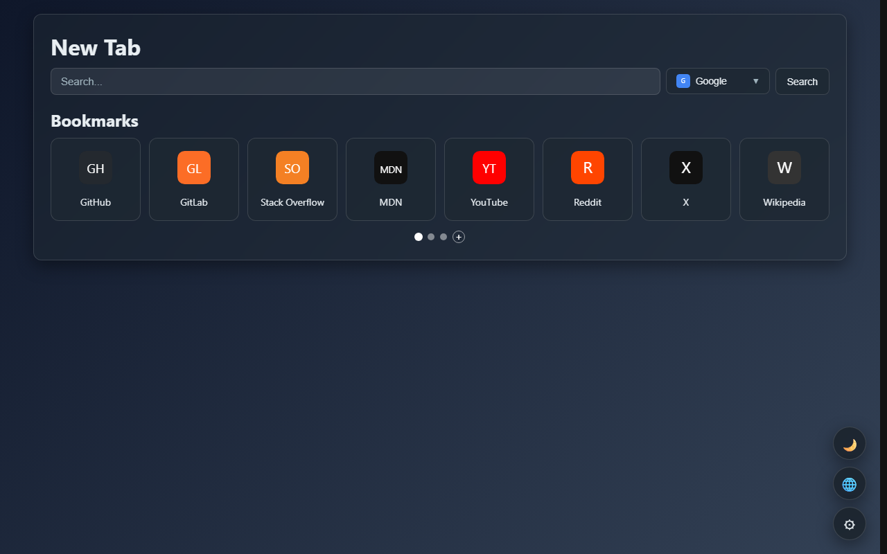 | 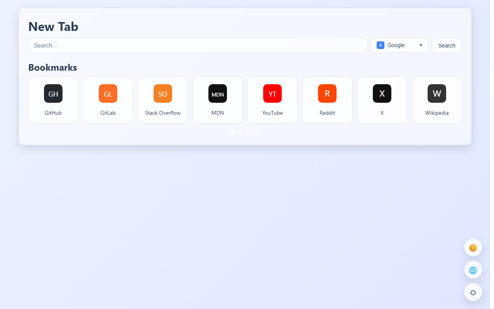 |

| Screens, dark | Screens, light |
|---|---|
| 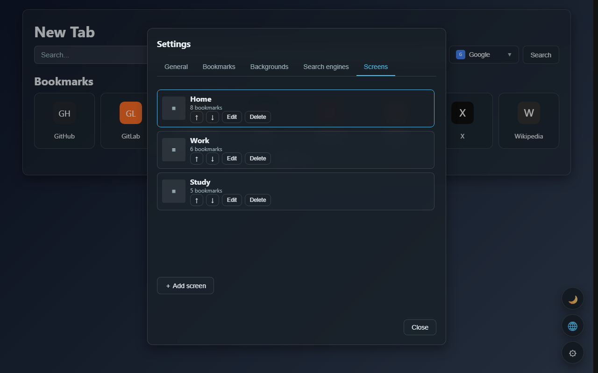 | 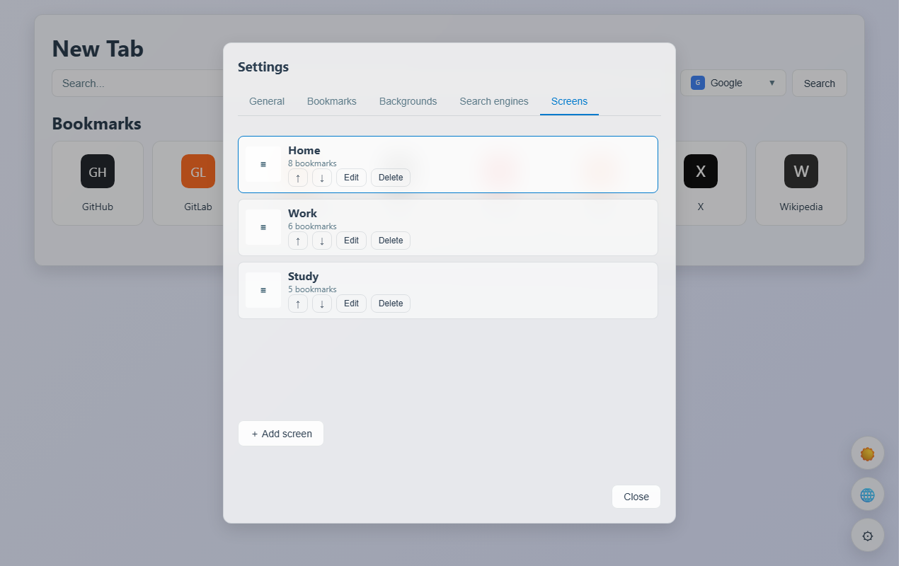 |

| Backgrounds, dark | Backgrounds, light |
|---|---|
| 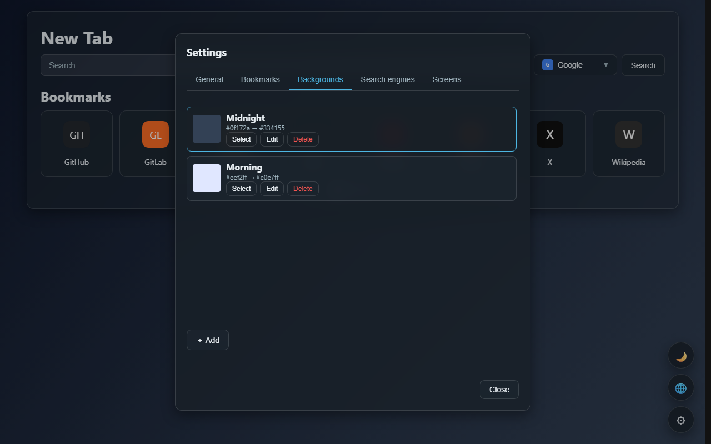 | 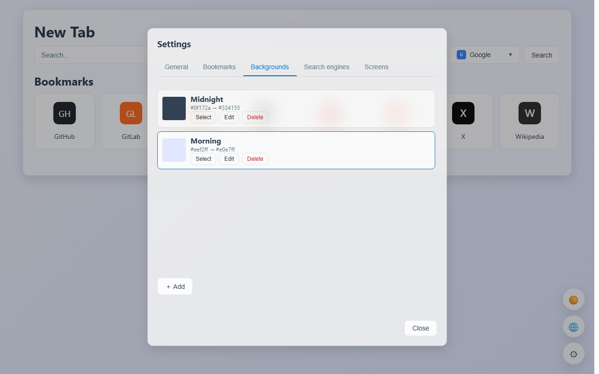 |

| Search engines, dark | Search engines, light |
|---|---|
| 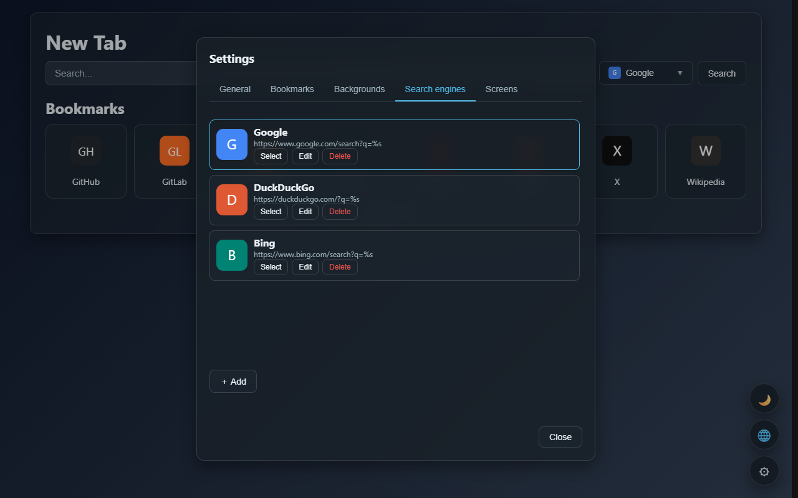 | 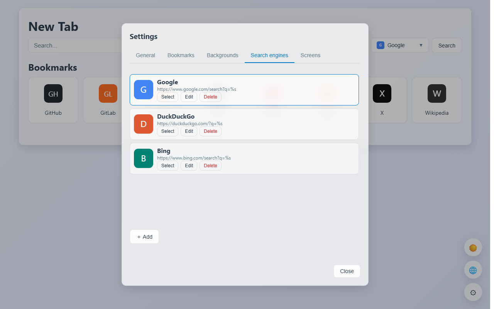 |

| Context menu, dark | Context menu, light |
|---|---|
| 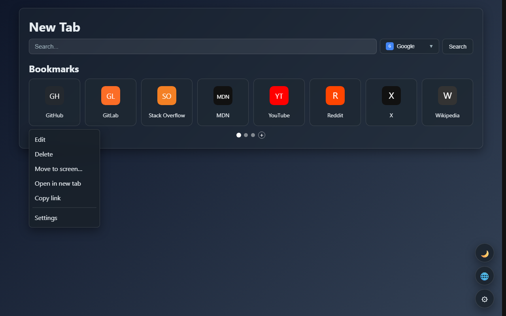 | 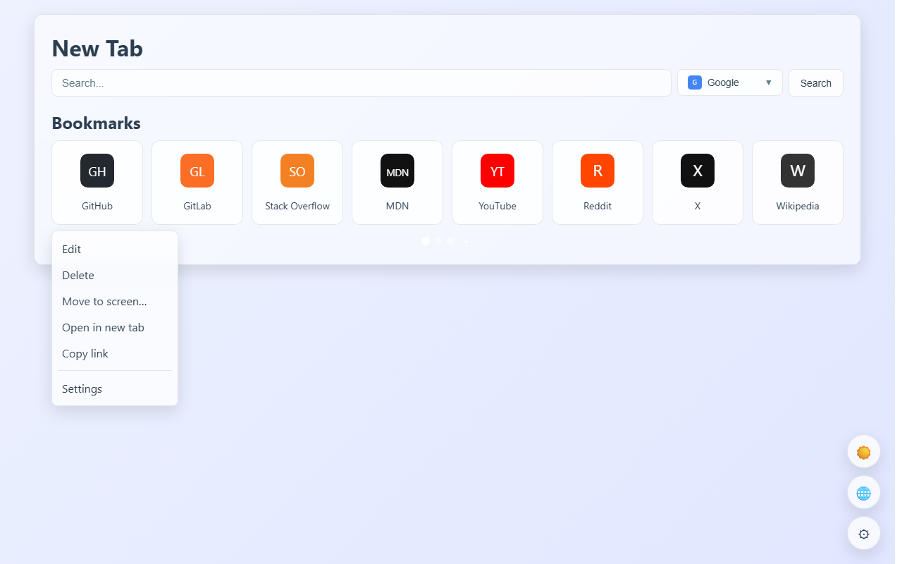 |

| Delete screen, dark | Delete screen, light |
|---|---|
| 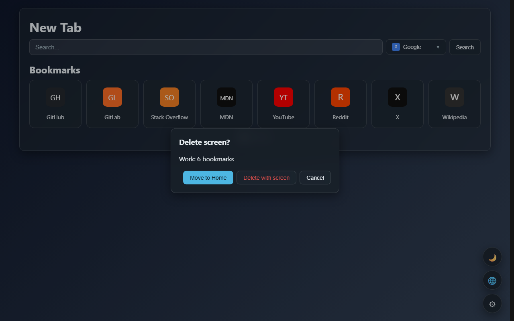 | 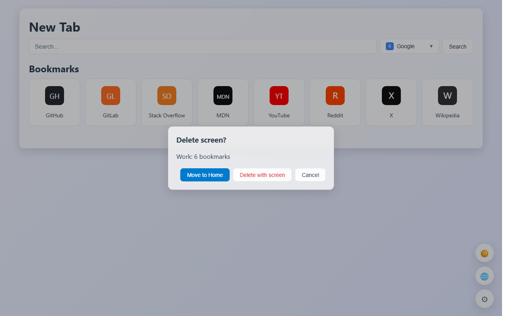 |

## Project structure

```
tabvale/
├── manifest.json              # Extension manifest (Manifest V3)
├── background.js              # Service worker: extension icon menu
├── newtab/
│   ├── index.html             # New tab page
│   ├── styles.css             # Styles
│   ├── app.js                 # Bootstrap: wires feature init functions
│   ├── core/                  # Core
│   │   ├── config.js          # Defaults
│   │   ├── storage.js         # chrome.storage, migrations, screens/backgrounds
│   │   ├── i18n.js            # t()/applyLocale localization
│   │   ├── render.js          # Rendering and context menu definitions
│   │   └── state.js           # DOM references and current state
│   └── features/              # Feature modules
│       ├── screens.js         # Screens, dots, swipe, moving bookmarks
│       ├── bookmarks.js       # Bookmark form and actions
│       ├── drag.js            # Tile drag-and-drop
│       ├── context-menu.js    # Context menus and actions
│       ├── search.js          # Search
│       ├── settings.js        # Settings modal, import/export
│       ├── backgrounds.js     # Background forms and list
│       ├── search-engines.js  # Search engine forms and list
│       ├── theme.js           # Theme
│       ├── language.js        # Language switching
│       ├── popovers.js        # Popover closing
│       └── ui-actions.js      # Shared actions and refreshUI
├── _locales/                  # 13 languages
├── assets/icons/              # Extension icons 16/48/128
├── docs/                      # CWS listing, privacy page, screenshots
│   ├── screenshots/
│   ├── CWS_LISTING.md
│   └── privacy.html
├── tests/                     # Node tests (vm sandbox)
├── tools/screenshot-sandbox/  # Screenshot generator
├── package.sh                 # Builds dist/tabvale_v{version}.zip (bash)
├── package.ps1                # Windows build (PowerShell)
├── PRIVACY.md                 # Privacy policy
├── CWS_REVIEW_NOTES.md        # Chrome Web Store review texts
├── TODO_PUBLICATION.md        # Publication checklist
├── LICENSE                    # MIT
├── README.*.md                # Short translations
└── README.md
```

## Installation

1. Open `chrome://extensions` or `edge://extensions`.
2. Enable Developer mode.
3. Click "Load unpacked" and select the project root.
4. Open a new tab.

## Build

```bash
bash package.sh
```

The script creates `dist/tabvale_v{version}.zip` with the runtime files:
`manifest.json`, `background.js`, `newtab/`, `_locales/` and the PNG icons.
The version is read from `manifest.json`.

### Windows

PowerShell 5.1 or newer:

```powershell
powershell -ExecutionPolicy Bypass -File .\package.ps1
```

The script uses Windows `tar.exe` when available and falls back to
`Compress-Archive`. It creates the same `dist/tabvale_v{version}.zip` and
checks that development files are not included.

If you use Git Bash, the Unix script works too (it uses Windows
`tar.exe`/bsdtar; GNU tar is rejected):

```bash
bash package.sh
```

## Tests

Node.js 18+ is required.

```bash
for f in tests/*.test.mjs; do node "$f" || exit 1; done
```

A single test:

```bash
node tests/screens.test.mjs
```

## Permissions

- `storage` — bookmarks, screens, backgrounds, search engines, theme.
- `unlimitedStorage` — background files in `chrome.storage.local`.
- `contextMenus` — the extension icon menu.
- `clipboardRead` — paste actions in the custom context menu.
- `optional_host_permissions` — requested per site, only to read a page
  `<title>` when adding a bookmark.

See [PRIVACY.md](PRIVACY.md) for details.

## Translations

Short localized versions are provided for convenience. English is the
authoritative version; translations may lag behind. The translations were
made by a non-native speaker and can be corrected via GitHub issues.

- [Русский](README.ru.md)
- [Deutsch](README.de.md)
- [Français](README.fr.md)
- [Español](README.es.md)
- [Português (Brasil)](README.pt-BR.md)
- [Italiano](README.it.md)
- [Polski](README.pl.md)
- [Türkçe](README.tr.md)
- [Українська](README.uk.md)
- [中文](README.zh.md)
- [日本語](README.ja.md)
- [한국어](README.ko.md)

## License

MIT. See [LICENSE](LICENSE).
